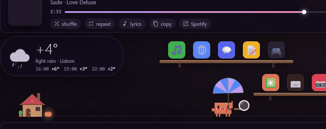
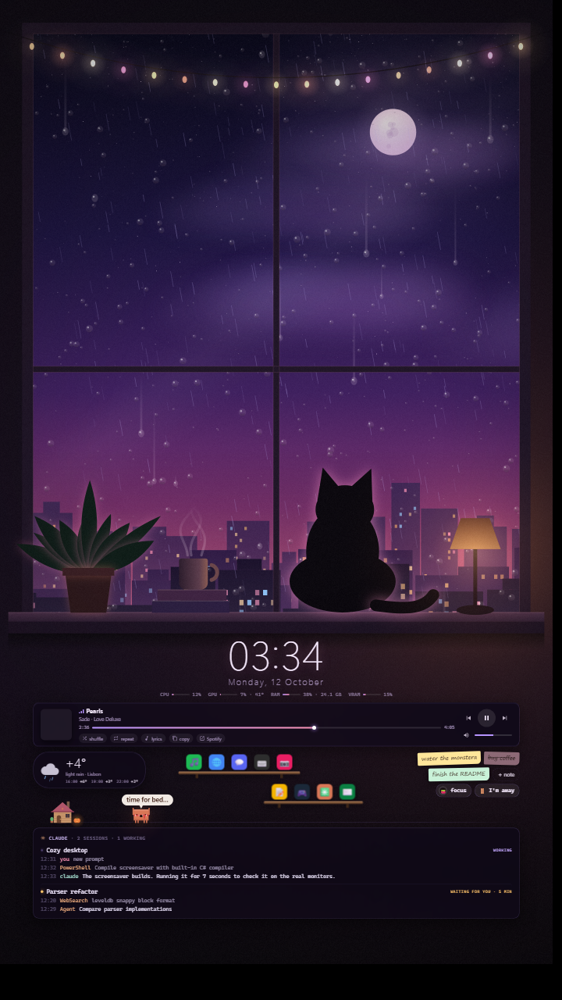
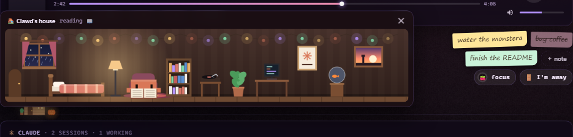
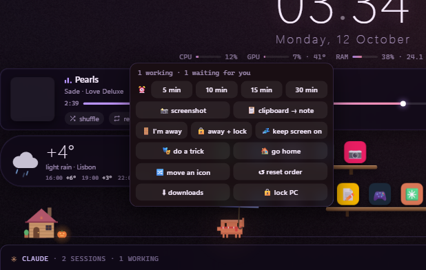

# Lofi Desk

**Уютные живые обои для Windows с маленьким компаньоном Claude Code прямо на рабочем столе.**

Пиксельный Клод следит за твоими сессиями Claude Code: радуется, когда задача готова, машет, когда у
Claude вопрос, живёт в своём домике, лазает по лестницам, пускает мыльные пузыри и ловит удочкой баги
из ленты. Вокруг — lo-fi сцена, плеер, погода, заметки, помодоро и полки быстрого запуска. Когда ты
отходишь, OLED-монитор становится полностью чёрным.

*[English](README.md) · Русский*

> Неофициальный фанатский проект, не связан с Anthropic. Целиком сделан в разговоре с Claude Code.

<p align="center"></p>

<p align="center">
  
  &nbsp;
  
</p>

## Что умеет

**Маскот (Клод)**
- Живёт над лентой Claude Code и реагирует на неё: печатает, когда Claude вызывает инструменты, оглядывается,
  когда тот читает файлы, говорит **«готово: …»**, когда сессия закончила, и **«вопрос: …»**, когда нужен ты.
  Клик по табличке открывает эту сессию в приложении Claude.
- Больше 60 анимаций: жонглирование, скейт, бумажные самолётики, бабочки, лестницы, шарики, колесо,
  лунная походка, рыбалка в ленте, мыльные пузыри, фокусы, звёзды ночью, кучи листьев осенью, лужи в дождь…
- Одевается по погоде (зонт, шарф, шапка, очки), ночью ходит с фонариком, на стриме — в наушниках.
- Его можно гладить курсором, таскать мышкой и выделять рамкой.
- **Домик.** Он уходит туда отдыхать и спать. Клик по домику — заглянуть внутрь: там обставленная комната,
  где он читает, играет в игры, поливает монстеру, пьёт чай, чинит гирлянду и болтает с рыбкой.
  По мебели можно кликать — он займётся этим.

**Рабочий стол**
- Две сцены: **lofi** (дождливое окно, кот, огни города) и **art** (твоя картинка, мягко оживлённая).
- Плеер для всего, что отдаёт трек в Windows (Spotify, браузеры, плееры): обложка, перемотка, громкость,
  перемешивание и повтор, поиск текста песни, волна под звук.
- Погода с почасовым прогнозом (Open-Meteo, без ключа), загрузка системы (CPU, GPU, RAM, VRAM).
- Стикеры-заметки, помодоро, быстрые таймеры, полки быстрого запуска со счётчиками непрочитанного.
- Кнопка **«я ушёл»**: ставит музыку и помодоро на паузу, отправляет маскота домой и гасит OLED;
  когда вернёшься — сводка, что закончилось без тебя.
- **Заставка**: основной монитор полностью чёрный (бережёт OLED), на остальных — сцена.
- Режим стрима (запущен OBS): личное в ленте и заметках размывается.
- Лимиты подписки Claude в шапке ленты.

## Что нужно

- Windows 10 или 11, x64. Лучше всего с двумя мониторами (сцена живёт на втором), но работает и с одним.
- WebView2 Runtime (в Windows 11 уже есть; [для Windows 10](https://developer.microsoft.com/microsoft-edge/webview2/)).
- [Claude Code](https://claude.com/claude-code) (терминал или приложение) — для ленты и реакций маскота.
  Без него остаются просто обои.

## Установка

1. Скачай zip последнего релиза и распакуй в постоянное место, например `C:\Users\ты\LofiDesk`
   (или `git clone` этого репозитория — при установке он соберётся сам).
2. Правый клик по `install.ps1` → **Выполнить с помощью PowerShell**, или:
   ```powershell
   powershell -ExecutionPolicy Bypass -File install.ps1
   ```
   Скрипт создаст `settings.ini`, добавит Lofi Desk в автозапуск, зарегистрирует заставку и поставит чёрные
   статичные обои на основной монитор. Лишнее можно пропустить: `-NoScreensaver`, `-NoBlackWallpaper`.
3. Поправь `settings.ini` (город, язык `lang=ru`, сцена) и выбери **Перезапустить обои** в меню трея.

Exe не подписан, поэтому SmartScreen может предупредить при первом запуске; его всегда можно собрать
самому из исходников через `build.ps1`.

## Настройки (`settings.ini`)

| ключ | значения | |
|---|---|---|
| `lang` | `en`, `ru` | язык интерфейса |
| `scene` | `lofi`, `art` | сцена |
| `art` | `art/картинка.jpg` | картинка для арт-сцены (см. [art/README.md](art/README.md)) |
| `feed` | `1`, `0` | лента Claude Code и маскот |
| `grain` | `1`, `0` | плёночное зерно |
| `city`, `lat`, `lon` | например `Москва`, `55.75`, `37.62` | погода; пустые `lat`/`lon` прячут виджет |
| `limits` | `0`, `1` | читать лимиты ещё и из кэша приложения Claude (недокументировано, по умолчанию выключено) |

Иконки быстрого запуска берутся из папки [`launch/`](launch/README.md).

## Как пользоваться



- **Клик по маскоту** → меню: таймеры, скриншот, буфер → заметка, загрузки, блокировка, «я ушёл»,
  «покажи трюк», «иди домой», перестановка полок.
- **Клик по домику** → заглянуть внутрь; **клик по мебели** внутри → он ею воспользуется.
- **Клик по сессии** в ленте → открыть её в приложении Claude.
- **Клик чуть выше пола или полки** → он туда придёт или запрыгнет.
- **Значок в трее** → я ушёл / я вернулся, перезапуск, настройки, выход.

### Лимиты подписки

- **Claude Code в терминале:** добавь строку состояния в `~/.claude/settings.json` — обои покажут 5-часовой
  и недельный лимиты:
  ```json
  "statusLine": { "type": "command", "command": "powershell -NoProfile -ExecutionPolicy Bypass -File C:/путь/к/LofiDesk/statusline.ps1", "refreshInterval": 60 }
  ```
- **Приложение Claude:** строку состояния оно не запускает. С `limits=1` Lofi Desk читает 5-часовое окно из
  локального кэша приложения; само приложение сохраняет его только когда расход высокий.

## Приватность

Всё работает локально. Лента читает журналы Claude Code из `~/.claude/projects` на твоём диске и никуда их не
отправляет. В сеть уходят только запрос погоды (Open-Meteo, раз в 15 минут) и пинг раз в 15 секунд, чтобы
показать, есть ли интернет.

## Удаление

Запусти `uninstall.ps1`, потом удали папку.

## Сборка из исходников

```powershell
powershell -ExecutionPolicy Bypass -File build.ps1            # build\LofiDesk.new.exe + scene.en.html
powershell -ExecutionPolicy Bypass -File build.ps1 -Install   # и заменить запущенную копию
```

SDK не нужен: используется компилятор C#, который есть в Windows (.NET Framework 4.x), а WebView2 SDK один
раз скачивается из NuGet. Устройство файлов и перевода описано в [английском README](README.md#building-from-source).

## Ограничения

- Делалось и проверялось на Windows 11 24H2 с двумя мониторами; на других конфигурациях может понадобиться
  подкрутить.
- Некоторые программы (запись игр, автоматизация) шлют синтетические нажатия клавиш, и Windows считает, что
  ты всё время за компьютером; поэтому простой и заставка смотрят только на мышь.
- Для арт-сцены нужна своя картинка — в комплекте её нет.

## Благодарности

- Погода — [Open-Meteo.com](https://open-meteo.com/) (CC BY 4.0).
- [Microsoft Edge WebView2](https://developer.microsoft.com/microsoft-edge/webview2/) SDK, скачивается при сборке под своей лицензией.
- Клод нарисован по мотивам маскота из терминала Claude Code. Claude и Claude Code — товарные знаки Anthropic;
  это независимый фанатский проект.

## Лицензия

[MIT](LICENSE)
